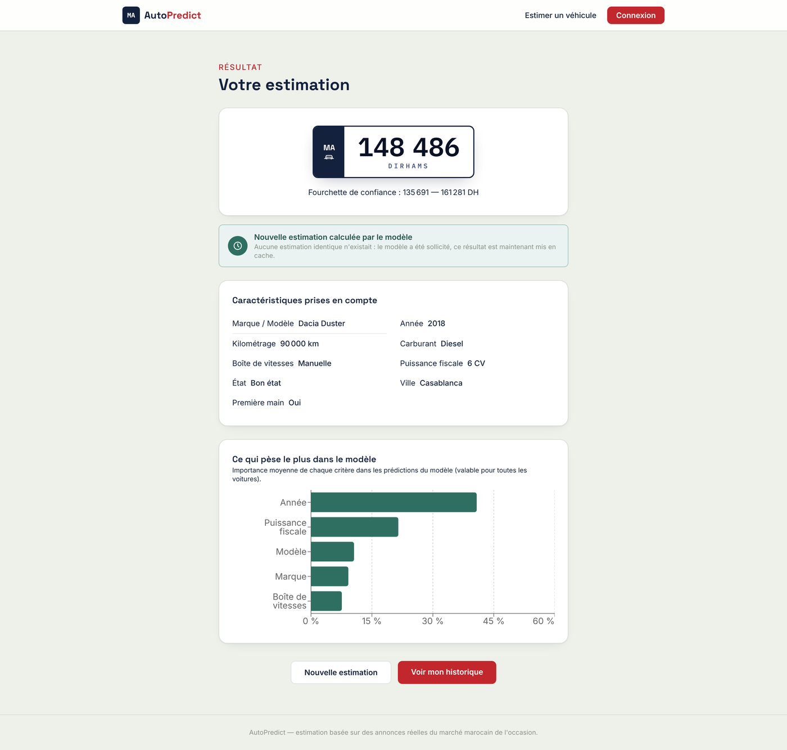
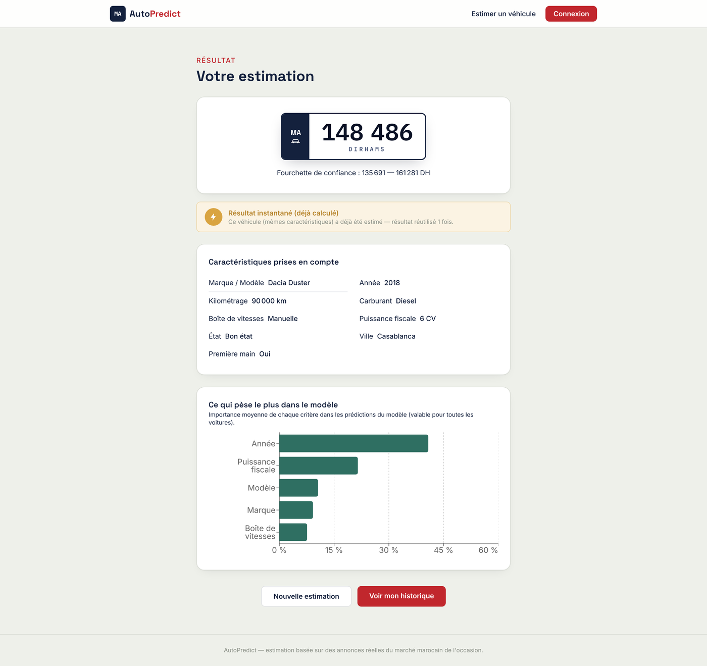
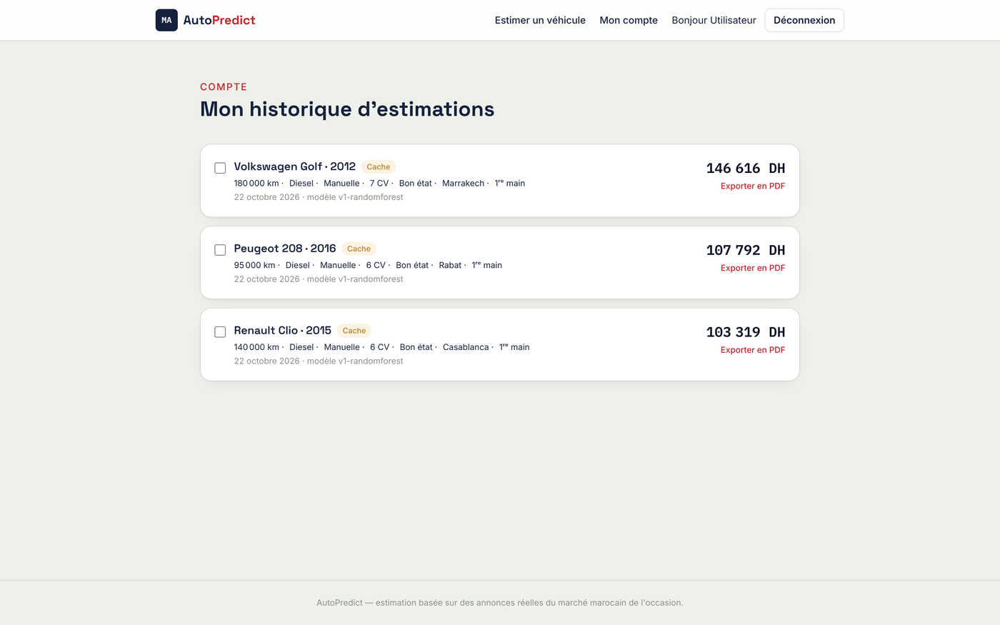
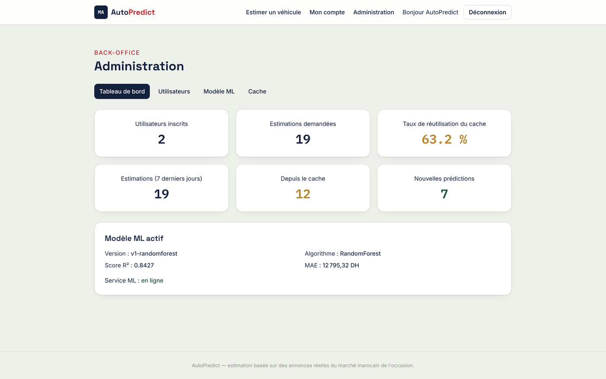

# AutoPredict

Application web qui estime le prix d'une voiture d'occasion au Maroc.
On renseigne les caractéristiques du véhicule (marque, modèle, année, kilométrage, carburant, ville...)
et un modèle de machine learning, entraîné sur des annonces Avito, renvoie un prix estimé avec une fourchette.


## Fonctionnalités

- **Estimation en 4 étapes** : véhicule, caractéristiques, localisation, récapitulatif.
- **Fourchette de prix** autour de l'estimation (prix estimé ± l'erreur moyenne du modèle).
- **Cache des estimations** : une voiture déjà estimée avec la version actuelle du modèle n'est pas recalculée.
- **Comptes utilisateurs** : historique, comparaison de plusieurs estimations, export en PDF ou CSV.
- **Back-office administrateur** : statistiques, gestion des utilisateurs, versions du modèle, supervision du cache.

| Formulaire | Résultat |
|---|---|
|  |  |

| Résultat servi par le cache | Historique de l'utilisateur |
|---|---|
|  |  |



## Comment ça marche

```
Navigateur  ->  frontend (React)  ->  backend (Express)  ->  service ML (Flask)
                                           |
                                        MySQL (utilisateurs, estimations, modèles, catalogue)
```

| Dossier | Rôle | Technologies | Port |
|---|---|---|---|
| `ml/` | nettoyage des données, entraînement, service de prédiction | Python, pandas, scikit-learn, Flask | 8000 |
| `backend/` | API REST, base de données, cache, comptes et administration | Node.js, Express, Sequelize, MySQL, JWT | 5000 |
| `frontend/` | interface web | React, Vite, Tailwind CSS, react-query | 5173 |

Le frontend ne parle jamais au service ML : tout passe par le backend.

### Le cache

Quand une estimation est demandée, le backend normalise les caractéristiques (texte en minuscules sans accents,
kilométrage arrondi par tranche de 5 000 km) et en calcule une empreinte SHA-256.

1. Si une estimation avec la même empreinte existe déjà pour le **modèle ML actif**, son résultat est renvoyé directement
   (`source: CACHE`) sans appeler le modèle.
2. Sinon, le service ML est appelé, le résultat est enregistré et renvoyé (`source: NOUVELLE_PREDICTION`).

Quand l'administrateur active une autre version du modèle, le cache est invalidé automatiquement, puisque la recherche
se fait sur l'identifiant du modèle actif.

## Le modèle de prédiction

- **Données** : 7 903 annonces Avito après nettoyage, 23 marques, 224 couples marque / modèle, 91 villes.
- **Modèles comparés** : régression linéaire, Random Forest, Gradient Boosting (et XGBoost s'il est installé).
  Le prix est appris en échelle logarithmique.
- **Modèle retenu** : Random Forest, **R² = 0,84** et **erreur moyenne d'environ 12 800 MAD** sur le jeu de test.
  Le détail est dans `ml/models/metrics.json`.

Limites à connaître :

- les données sont des annonces (prix demandés, pas prix de vente) ;
- 91 % des annonces sont des voitures diesel : l'essence, l'hybride et l'électrique sont peu couverts ;
- le modèle réagit peu à l'état déclaré du véhicule et au kilométrage ;
- les données s'arrêtent en 2022 ;
- le graphique affiché après l'estimation montre le poids moyen de chaque critère dans le modèle,
  pas une explication calculée pour chaque voiture.

## Lancer le projet

Il faut Python 3.10+, Node.js 18+ et MySQL (XAMPP convient). On lance les trois parties dans trois terminaux.

**1. Service ML**

```bash
cd ml
pip install -r requirements.txt
python src/api.py
```

Le modèle entraîné est déjà dans `ml/models/`. Pour le réentraîner (environ 2 minutes) :

```bash
python src/preprocessing.py   # nettoie le CSV Avito -> data/processed/cars_clean.csv
python src/train.py           # compare les modèles et sauvegarde le meilleur dans models/
```

**2. Backend**

```bash
cd backend
npm install
cp .env.example .env          # puis renseigner DB_PASSWORD (vide avec XAMPP) et un JWT_SECRET long et aléatoire
mysql -u root -p -e "CREATE DATABASE autopredict CHARACTER SET utf8mb4;"
npm run db:seed               # tables, comptes de démonstration, catalogue, modèle actif
npm run dev
```

**3. Frontend**

```bash
cd frontend
npm install
cp .env.example .env
npm run dev
```

Ouvrir ensuite http://localhost:5173 (avec `localhost`, pas `127.0.0.1`).

Comptes de démonstration créés par le seed :

- administrateur : `admin@autopredict.ma` / `Admin123!`
- utilisateur : `user@autopredict.ma` / `User1234!`

> Ces comptes sont publics et servent uniquement à la démonstration en local.
> Le fichier `.env` n'est jamais publié : il est dans le `.gitignore`.

## Documentation par partie

- [`backend/README.md`](backend/README.md) : routes de l'API, base de données, fonctionnement du cache
- [`frontend/README.md`](frontend/README.md) : structure de l'interface
- chaque fichier de `ml/src/` commence par une description de son rôle


## Équipe

- **Sofyane** ([@Sofyane00](https://github.com/Sofyane00)) : données, modèle ML et service de prédiction
- **Othmane** ([@othmaneelmghari](https://github.com/othmaneelmghari)) : backend
- **Mohammed** ([@El-abbadi05](https://github.com/El-abbadi05)) : frontend
